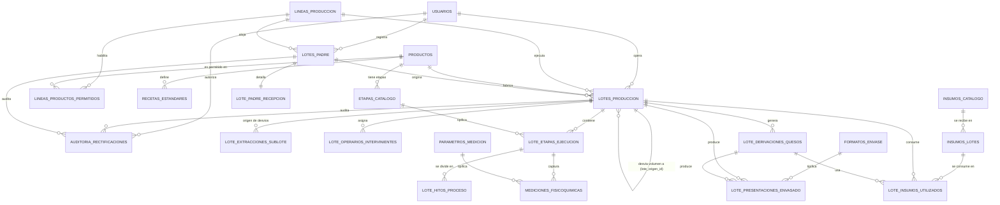
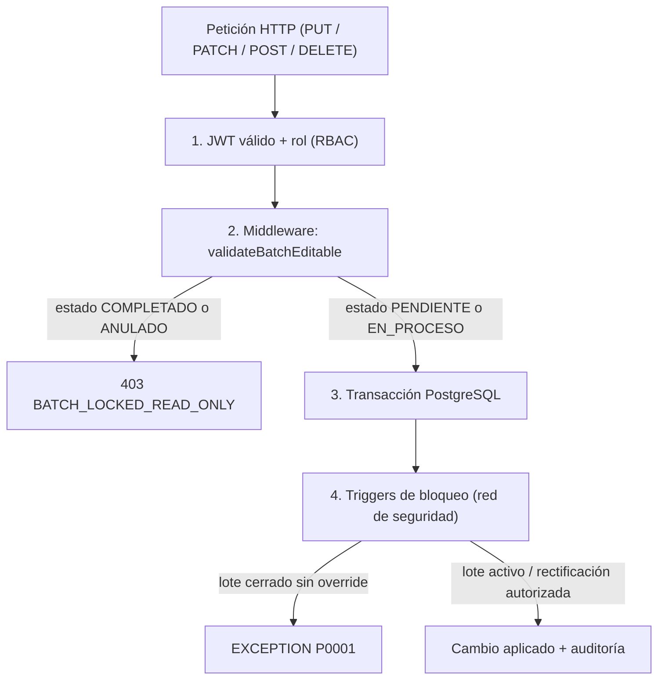

# Arquitectura Técnica de Backend y Modelo Relacional (PostgreSQL + Node.js)
**Sistema de Control de Producción y Supervisión SCADA Láctea**
*Documento de Diseño de Base de Datos, Persistencia y Seguridad de Producción*

| Control de documento | |
| :--- | :--- |
| **Versión** | 1.1 — Revisión final (Sign-off) |
| **Estado** | Aprobado por gerencia · Única fuente de la verdad (SSOT) para el backend |
| **Alcance de código** | Documento de diseño. No altera `src/` ni crea migraciones. |
| **Cambios v1.0 → v1.1** | Cierre de brechas detectadas en el análisis de tipos del frontend (§2.4), corrección de triggers, integración de las 5 decisiones de gerencia (§5), eliminación de "Pendientes de Confirmación". |

---

## 1. Inventario y Clasificación de Estado (React a SQL)

El frontend (React + Vite) distribuye su estado operativo entre el orquestador `useBatchManager.ts`, los modelos de lote (`BatchData`, `YogurBatchData`, `KumisBatchData`, `YogurGriegoBatchData`) y los componentes de etapa. Para el backend (Node.js + Express + PostgreSQL) se separan los **estados efímeros de interfaz** de los **datos transaccionales y de trazabilidad industrial**.

### 1.1. Matriz de Clasificación de Estados

| Dominio | Estado en React (Frontend) | Clasificación | Destino en Backend / PostgreSQL | Justificación Técnica |
| :--- | :--- | :--- | :--- | :--- |
| **Navegación y Vista** | `currentView`, `activeProductId`, `selectedLineId`, `mobileOpen` | **Efímero (UI)** | *Ninguno* | Estado de sesión local del cliente. |
| **Pestañas de Sub-Lotes** | `subBatchTabs`, `stagesByProduct` | **Efímero (UI)** | *Ninguno (se calcula)* | Se derivan de los lotes con volumen > 0. La etapa actual sí se persiste en `lotes_produccion.etapa_actual_codigo`. |
| **Control de Modales** | `reviewModalOpen`, `correctionModalOpen`, `showModalExtraccion`, `errorExtraccion` | **Efímero (UI)** | *Ninguno* | Disparadores visuales. |
| **Cronómetros en vivo** | `isRunning`, `formattedTime`, `elapsedSeconds`, `useStageCountdown`, `useIndependentBatchTimer` | **Efímero (UI)** | *Ninguno (derivado)* | El cronómetro visible se recalcula en el cliente desde marcas absolutas. Se persisten solo `iniciado_at` / `finalizado_at`. |
| **Flags de captura manual** | `esManual`, `esCuajoManual`, `temperaturaManual`, `horaManual`, `esManualPaso2/3`, `esPesoManual`, `edicionManualAvanzada` | **Persistente (flag)** | Columna `es_captura_manual BOOLEAN` | Auditoría BPM: distingue un dato tomado por botón de uno editado a mano (ver §5, decisión 3). |
| **Lote Padre (Leche)** | `ParentMilkBatch`: `codigoLotePadre`, `totalMilkLiters`, `allocatedLiters`, `remainingLiters`, `proveedorPrincipal`, `loteLecheProveedor`, `isStarted`, `isDivided` | **Persistente** | `lotes_padre`, `lote_padre_recepcion` | Recepción de materia prima y trazabilidad agropecuaria. |
| **Lotes Hijos / Derivados** | `ChildBatchReference`: `variant`, `allocatedLiters`, `llevaAzucar`, `status` | **Persistente** | `lotes_produccion` (+ `lote_origen_id`) | Vínculo formal con el lote padre y con el lote del que se desvía el volumen. |
| **Desvíos de volumen** | `extraccionKumis`, `extraccionGriego`, `litrosExtraidos`, `prevExtraidos`, `divisionLeche` | **Persistente** | `lote_extracciones_sublote` | Historial de cada desvío (reversible) con litros anterior/nuevo. |
| **Hitos cronometrados** | `calentamiento`, `sostenimiento`, `enfriamiento`, `trasiego`, `incubacion`, `cuartoFrio`, `filtradoTelas`, `batido`, `cuajado`, `corte`, `desuerado`, `escurrido`, `hiladoEnPaila`… | **Persistente** | `lote_hitos_proceso` | Cada sub-paso tiene inicio, fin y duración propios dentro de una etapa. |
| **Parámetros físico-químicos** | `temperaturaConsigna/Alcanzada`, `phMezcla`, `acidezDornic`, `phEscurrido`, `acidezSuero`, `lecturasPhReposo[]`, `masaFiltradaKg`, `sueroEliminadoEstimadoLitros`, `velocidadRpm` | **Persistente** | `mediciones_fisicoquimicas` + `parametros_medicion` | Puntos críticos de control; las lecturas múltiples (pH de reposo) son filas. |
| **Insumos y trazabilidad** | `loteLeche1/2`, `loteCuajo`, `loteCultivo`, `loteSal`, `loteAzucar`, `loteEstevia`, `loteSaborizante`, `loteColorante`, `loteAcidoAcetico`, cantidades | **Persistente** | `insumos_catalogo`, `insumos_lotes`, `lote_insumos_utilizados` | Rastreo hacia atrás de cada bulto/frasco usado, con snapshot del nombre. |
| **Envasado / moldeo** | `formatos*`, `formatosKumis`, `formatosSinEstevia/ConEstevia`, `moldesDesglose` | **Persistente** | `formatos_envase`, `lote_presentaciones_envasado` | Conteo por formato; el total y el rendimiento se derivan. |
| **Derivaciones de quesos** | `derivaciones` (Mexicano, Finas Hierbas), `derivaciones7Cueros` (Arequipe, Bocadillo), `especias*` | **Persistente** | `lote_derivaciones_quesos` | Sub-productos con sus insumos y moldes propios. |
| **Cierre en cuarto frío** | `almacenamientoCuartoFrio.ingresado`, `horaIngreso`, `temperaturaAlmacenamiento`, `procesoFinalizado` | **Persistente** | Columnas en `lotes_produccion` | Define el fin del ciclo del sistema (§5, decisión 5). |
| **Observaciones** | `observaciones` (lote), notas de desvío total | **Persistente** | `lotes_produccion.observaciones_finales` y `lote_etapas_ejecucion.observaciones` | Texto libre de operario o del sistema. |
| **Gobernanza y auditoría** | `responsableProceso`, `operariosIntervinientes`, `auditLogs` | **Persistente** | `lote_operarios_intervinientes`, `auditoria_rectificaciones` | Registro inmutable de responsables y cambios autorizados. |
| **Maestros** | `ProductDefinition`, `ProductionLine` (+ `allowedProductIds`), `UserProfile` | **Persistente** | `productos`, `lineas_produccion`, `lineas_productos_permitidos`, `usuarios` | Datos de configuración administrados desde el panel. |

---

### 1.2. Estandarización de Nomenclatura (camelCase → snake_case)

Inconsistencias detectadas en el frontend actual:

| Inconsistencia detectada | Ejemplos | Resolución en backend |
| :--- | :--- | :--- |
| Hora como texto **y** como timestamp para el mismo evento | `horaInicio` (`"10:14:25 AM"`) + `timestampInicio` (ms) | Una sola columna `iniciado_at TIMESTAMPTZ`. |
| Distinto prefijo según etapa | `timestampDesuerado`, `timestampCuajo`, `timestamp40Grados`, `timestampPh58`, `timestampFinEscurrido` | Un único par `iniciado_at` / `finalizado_at` por hito (`lote_hitos_proceso`). |
| `hora*` sin timestamp asociado | `horaAdicion`, `horaLlegada85a90`, `hora` (extracciones) | Se persisten como `TIMESTAMPTZ` (`registrado_at`). |
| Duraciones como texto | `tiempoCalentamiento: "14 min 32 s"`, `tiempoTranscurrido` | `duracion_segundos INTEGER`; el texto lo genera la UI. |
| Duplicidad de lote de leche | `loteLeche1`, `loteLeche2`, `loteLecheBase`, `loteLecheFresca`, `loteLeche` | Filas en `lote_insumos_utilizados` (`tipo_insumo='leche_fresca' / 'leche_acida'`). |
| Mismo concepto con nombres distintos | `completado`/`completada`/`finalizado`/`registrado`/`alcanzado`/`confirmado` | `estado` de la etapa + presencia de `finalizado_at`. |
| Mismo concepto por tipo de lote | `operator` + `operatorRole` + `responsableProceso` | `responsable_id` (FK a `usuarios`). |
| Estado con dos vocabularios | `'NOMINAL' \| 'EN AJUSTE' \| 'COMPLETADO'` (lote) vs `'pendiente' \| 'en_proceso' \| 'completado'` (hijo) | `estado_lote_enum` único (ver tabla). Se conserva `en_ajuste BOOLEAN`. |
| Reutilización de `StageId` de quesos en fermentados | `desuerar` = "Cuarto Frío / Mallas", `hilar` = "Batido" | `etapas_catalogo` por producto (`UNIQUE(producto_id, codigo_ui)`). |

#### Reglas de nomenclatura
1. **Tiempos:** todo instante es `TIMESTAMPTZ` (`_at`); zona de planta `America/Bogota`. Duraciones en `_segundos INTEGER`.
2. **Columnas:** `snake_case`, sin abreviaturas ambiguas.
3. **Unidades:** explícitas en el nombre cuando la columna es una magnitud (`_litros`, `_celsius`, `_gramos`, `_kg`, `_dornic`, `_porcentaje`, `_rpm`). Las mediciones genéricas heredan la unidad de `parametros_medicion`.

#### Tabla de equivalencias

| Variable React / TypeScript | Nombre en PostgreSQL | Tipo | Regla de conversión |
| :--- | :--- | :--- | :--- |
| `batch.id` / `codigoLotePadre` | `codigo_lote` | `VARCHAR(50) UNIQUE` | Código visible de planta (`LP-20261026-01`, `Lote YOG-01`). |
| `status` `NOMINAL` / `EN AJUSTE` | `estado = 'EN_PROCESO'` + `en_ajuste` | `estado_lote_enum`, `BOOLEAN` | `EN AJUSTE` se conserva como bandera informativa. |
| `status` `COMPLETADO` | `estado = 'COMPLETADO'` | `estado_lote_enum` | Se alcanza al ingresar a cuarto frío (o por desvío total). |
| `ChildBatchReference.status` `pendiente` / `en_proceso` / `completado` | `PENDIENTE` / `EN_PROCESO` / `COMPLETADO` | `estado_lote_enum` | Mapeo 1 a 1. |
| `horaInicio` + `timestampInicio` | `iniciado_at` | `TIMESTAMPTZ` | Se descarta la hora en texto. |
| `horaFin` + `timestampFin` | `finalizado_at` | `TIMESTAMPTZ` | Idem. |
| `tiempoCalentamiento`, `duracionReal`, `segundosEscurrido` | `duracion_segundos` | `INTEGER` | Derivable de los dos timestamps. |
| `temperaturaAlcanzada`, `tempConsigna`, `temperaturaVerificada` | fila en `mediciones_fisicoquimicas` (`temperatura_*`) | `NUMERIC(8,2)` | Una fila por medición. |
| `phRecepcion` | `lote_padre_recepcion.ph_recepcion` | `NUMERIC(4,2)` | Recepción de leche. |
| `phMezcla`, `phEscurrido`, `phFinalIncubacion`, `lecturasPhReposo[]` | filas `ph_*` en `mediciones_fisicoquimicas` | `NUMERIC(8,2)` | Varias lecturas ⇒ varias filas ordenadas por `registrado_at`. |
| `acidezDornic` | `acidez_dornic` / parámetro | `NUMERIC(5,2)` | °D. |
| `litrosLeche`, `totalMilkLiters` | `volumen_leche_base_litros` / `total_leche_litros` | `NUMERIC(10,2)` | Volumen del lote. |
| `litrosExtraidos` | `lote_extracciones_sublote.litros_nuevos` | `NUMERIC(10,2)` | Con `litros_anteriores` para la reversibilidad. |
| `loteCultivo`, `loteCuajo`, `loteSal`, `loteAzucar`, `loteEstevia`… | `lote_insumos_utilizados.codigo_lote_insumo` | `VARCHAR(80)` | + FK opcional `insumo_lote_id`. |
| `cantidadCuajoGramos`, `cantidadAzucarKg`, `saborizanteMl`… | `lote_insumos_utilizados.cantidad_utilizada` + `unidad_medida` | `NUMERIC(10,3)` | Una fila por insumo. |
| `pesoInicialGramos` / `pesoFinalGramos` / `pesoUtilizadoGramos` | `peso_inicial_gramos` / `peso_final_gramos` / `cantidad_utilizada` | `NUMERIC(10,3)` | `utilizado = inicial − final` (CHECK). |
| `formatos.*`, `formatosKumis.*`, `moldesDesglose.*` | filas de `lote_presentaciones_envasado` | `INTEGER` | Una fila por formato con unidades > 0. |
| `responsableProceso` / `operator` | `responsable_id` | `UUID` | FK a `usuarios`. |
| `operariosIntervinientes[]` | `lote_operarios_intervinientes` | tabla puente | Una fila por operario. |
| `observaciones` | `observaciones_finales` | `TEXT` | Texto libre. |
| `ProcessTimerState.startTimestamp` | `lotes_produccion.iniciado_at` | `TIMESTAMPTZ` | El resto del `ProcessTimerState` es efímero. |
| `AuditLogEntry.*` | `auditoria_rectificaciones.*` | ver §2.3 | Mapeo directo + destino exacto del dato. |

---

## 2. Propuesta de Modelo Relacional (PostgreSQL)

El diseño cumple **3FN** para datos maestros y transaccionales, y aplica el **patrón de instantánea (snapshot)** donde la inmutabilidad histórica prevalece sobre la normalización.

### 2.1. Inmutabilidad e Instantáneas (Snapshots)

> [!IMPORTANT]
> Si un lote solo guardara claves foráneas a recetas, insumos o formatos, cualquier cambio posterior en esos maestros alteraría retroactivamente lotes ya cerrados.

| Dato maestro | Qué se congela en el lote | Dónde |
| :--- | :--- | :--- |
| Receta / norma técnica | Receta vigente completa (`receta_snapshot JSONB`) y `norma_tecnica_aplicada` | `lotes_produccion` |
| Nombre y unidad del insumo | `insumo_nombre_snapshot`, `unidad_medida`, `codigo_lote_insumo`, `proveedor` | `lote_insumos_utilizados` |
| Formato de envase | `descripcion_formato`, `capacidad_unitaria`, `unidad_medida` | `lote_presentaciones_envasado` |
| Nombre del operario | Solo FK a `usuarios`; los usuarios **no se borran** (`activo = FALSE`) | `usuarios` |
| Nombre de etapa / producto | Mapa `etapa_label` en cada rectificación | `auditoria_rectificaciones` |

Reglas complementarias:
1. `recetas_estandares` se versiona (`version_receta`); una versión publicada **no se edita**, se crea una nueva.
2. Los maestros referenciados por lotes usan `ON DELETE RESTRICT` y baja lógica (`activo`).
3. `JSONB` se usa **únicamente** en `receta_snapshot` / `especificaciones_json` (documento de especificación congelado). Todo dato operativo es columnar.

---

### 2.2. Diagrama Entidad-Relación



---

### 2.3. Esquema DDL en PostgreSQL

> Orden de creación respeta dependencias entre claves foráneas.

```sql
CREATE EXTENSION IF NOT EXISTS "uuid-ossp";

-- ============================================================================
-- 0. TIPOS ENUMERADOS
-- ============================================================================
CREATE TYPE tipo_linea_enum     AS ENUM ('pasta_hilada', 'fermentacion', 'dulces');
CREATE TYPE rol_usuario_enum    AS ENUM ('superadmin', 'administrador', 'operador');
CREATE TYPE estado_linea_enum   AS ENUM ('disponible', 'en_produccion', 'mantenimiento', 'limpieza_cip');
CREATE TYPE estado_lote_enum    AS ENUM ('PENDIENTE', 'EN_PROCESO', 'COMPLETADO', 'ANULADO');
CREATE TYPE motivo_cierre_enum  AS ENUM ('CUARTO_FRIO', 'DESVIO_TOTAL');
CREATE TYPE estado_etapa_enum   AS ENUM ('pendiente', 'en_proceso', 'completada');
CREATE TYPE accion_auditoria_enum AS ENUM ('RECTIFICACION', 'ANULACION');

-- ============================================================================
-- 1. GOBIERNO: LÍNEAS, USUARIOS, PRODUCTOS
-- ============================================================================
CREATE TABLE lineas_produccion (
    id UUID PRIMARY KEY DEFAULT uuid_generate_v4(),
    codigo VARCHAR(30) UNIQUE NOT NULL,
    nombre VARCHAR(100) NOT NULL,
    tipo_linea tipo_linea_enum NOT NULL,
    capacidad_litros NUMERIC(10,2) NOT NULL CHECK (capacidad_litros > 0),
    estado estado_linea_enum NOT NULL DEFAULT 'disponible',
    activo BOOLEAN NOT NULL DEFAULT TRUE,
    created_at TIMESTAMPTZ NOT NULL DEFAULT NOW(),
    updated_at TIMESTAMPTZ NOT NULL DEFAULT NOW()
);

CREATE TABLE usuarios (
    id UUID PRIMARY KEY DEFAULT uuid_generate_v4(),
    codigo_empleado VARCHAR(30) UNIQUE NOT NULL,
    nombre_completo VARCHAR(120) NOT NULL,
    rol rol_usuario_enum NOT NULL,
    turno VARCHAR(40) NOT NULL DEFAULT 'Jornada Continua',
    pin_hash VARCHAR(255) NOT NULL,
    password_hash VARCHAR(255) NOT NULL,
    linea_asignada_id UUID REFERENCES lineas_produccion(id) ON DELETE SET NULL,
    activo BOOLEAN NOT NULL DEFAULT TRUE,   -- los usuarios no se borran: baja lógica
    created_at TIMESTAMPTZ NOT NULL DEFAULT NOW(),
    updated_at TIMESTAMPTZ NOT NULL DEFAULT NOW()
);

CREATE TABLE productos (
    id UUID PRIMARY KEY DEFAULT uuid_generate_v4(),
    codigo VARCHAR(30) UNIQUE NOT NULL,
    nombre VARCHAR(120) NOT NULL,
    tipo_linea tipo_linea_enum NOT NULL,
    descripcion TEXT,
    norma_tecnica VARCHAR(100) NOT NULL,           -- 'NTC-589', 'NTC-805'
    activo BOOLEAN NOT NULL DEFAULT TRUE,
    created_at TIMESTAMPTZ NOT NULL DEFAULT NOW()
);

-- Equivale a ProductionLine.allowedProductIds (relación N:M, 1FN)
CREATE TABLE lineas_productos_permitidos (
    linea_id UUID NOT NULL REFERENCES lineas_produccion(id) ON DELETE CASCADE,
    producto_id UUID NOT NULL REFERENCES productos(id) ON DELETE RESTRICT,
    PRIMARY KEY (linea_id, producto_id)
);

CREATE TABLE recetas_estandares (
    id UUID PRIMARY KEY DEFAULT uuid_generate_v4(),
    producto_id UUID NOT NULL REFERENCES productos(id) ON DELETE RESTRICT,
    version_receta INTEGER NOT NULL DEFAULT 1,
    temp_pasteurizacion_min NUMERIC(5,2),
    temp_pasteurizacion_max NUMERIC(5,2),
    tiempo_sostenimiento_segundos INTEGER,
    temp_enfriamiento_objetivo NUMERIC(5,2),
    temp_incubacion_objetivo NUMERIC(5,2),
    tiempo_incubacion_min_segundos INTEGER,
    ph_objetivo_corte NUMERIC(4,2),
    dias_vida_util_vencimiento INTEGER,
    especificaciones_json JSONB NOT NULL,          -- documento congelado de la receta
    activo BOOLEAN NOT NULL DEFAULT TRUE,
    created_at TIMESTAMPTZ NOT NULL DEFAULT NOW(),
    UNIQUE (producto_id, version_receta)
);

-- Etapas por PRODUCTO: yogur (4), kumis (3), griego (5), quesos (5).
-- 'codigo_ui' es el StageId del frontend, cuyo significado depende del producto.
CREATE TABLE etapas_catalogo (
    id UUID PRIMARY KEY DEFAULT uuid_generate_v4(),
    producto_id UUID NOT NULL REFERENCES productos(id) ON DELETE RESTRICT,
    codigo_ui VARCHAR(40) NOT NULL,                -- 'acidificar','calentar-y-cuajar','desuerar','hilar','moldeo'
    nombre VARCHAR(100) NOT NULL,
    orden_secuencia INTEGER NOT NULL,
    UNIQUE (producto_id, codigo_ui),
    UNIQUE (producto_id, orden_secuencia)
);

-- ============================================================================
-- 2. CATÁLOGOS DE MEDICIÓN, INSUMOS Y ENVASES (3FN)
-- ============================================================================
CREATE TABLE parametros_medicion (
    codigo VARCHAR(60) PRIMARY KEY,                -- 'temperatura_alcanzada','ph_mezcla','acidez_suero','masa_filtrada_kg'...
    nombre VARCHAR(120) NOT NULL,
    unidad VARCHAR(20) NOT NULL                    -- '°C','pH','% LA','°D','RPM','kg','L'
);

CREATE TABLE insumos_catalogo (
    id UUID PRIMARY KEY DEFAULT uuid_generate_v4(),
    codigo VARCHAR(40) UNIQUE NOT NULL,
    nombre VARCHAR(120) NOT NULL,
    tipo_insumo VARCHAR(50) NOT NULL,              -- 'leche_fresca','leche_acida','cuajo','cultivo','azucar','sal','estevia','saborizante','colorante','acido_acetico','especia','arequipe','bocadillo'
    unidad_base VARCHAR(20) NOT NULL,              -- 'L','g','kg','ml','unidades','cucharadas'
    activo BOOLEAN NOT NULL DEFAULT TRUE,
    created_at TIMESTAMPTZ NOT NULL DEFAULT NOW()
);

-- Lotes de insumo recibidos (bultos, frascos). Permite trazabilidad hacia atrás.
CREATE TABLE insumos_lotes (
    id UUID PRIMARY KEY DEFAULT uuid_generate_v4(),
    insumo_id UUID NOT NULL REFERENCES insumos_catalogo(id) ON DELETE RESTRICT,
    codigo_lote VARCHAR(80) NOT NULL,
    proveedor VARCHAR(150),
    fecha_vencimiento DATE,
    cantidad_recibida NUMERIC(12,3),
    activo BOOLEAN NOT NULL DEFAULT TRUE,
    created_at TIMESTAMPTZ NOT NULL DEFAULT NOW(),
    UNIQUE (insumo_id, codigo_lote)
);

CREATE TABLE formatos_envase (
    id UUID PRIMARY KEY DEFAULT uuid_generate_v4(),
    codigo VARCHAR(60) UNIQUE NOT NULL,            -- 'botella_200ml','tarro_1L','tarrina_500g','molde_400g','pera_grande_350g'
    descripcion VARCHAR(120) NOT NULL,
    tipo_linea tipo_linea_enum NOT NULL,
    categoria_variedad VARCHAR(50) NOT NULL DEFAULT 'estandar', -- 'con_azucar','sin_azucar','stevia','natural'
    capacidad_unitaria NUMERIC(10,3) NOT NULL CHECK (capacidad_unitaria > 0),
    unidad_medida VARCHAR(10) NOT NULL CHECK (unidad_medida IN ('L','kg')),
    activo BOOLEAN NOT NULL DEFAULT TRUE
);

-- ============================================================================
-- 3. LOTES PADRE (RECEPCIÓN DE LECHE)
-- ============================================================================
CREATE TABLE lotes_padre (
    id UUID PRIMARY KEY DEFAULT uuid_generate_v4(),
    codigo_lote VARCHAR(50) UNIQUE NOT NULL,
    linea_id UUID NOT NULL REFERENCES lineas_produccion(id) ON DELETE RESTRICT,
    responsable_id UUID NOT NULL REFERENCES usuarios(id) ON DELETE RESTRICT,
    fecha_produccion DATE NOT NULL DEFAULT CURRENT_DATE,
    total_leche_litros NUMERIC(10,2) NOT NULL CHECK (total_leche_litros > 0),
    litros_asignados NUMERIC(10,2) NOT NULL DEFAULT 0 CHECK (litros_asignados >= 0),
    litros_remanentes NUMERIC(10,2) NOT NULL CHECK (litros_remanentes >= 0),
    proveedor_principal VARCHAR(150) NOT NULL,
    lote_leche_proveedor VARCHAR(80) NOT NULL,
    estado estado_lote_enum NOT NULL DEFAULT 'PENDIENTE',
    iniciado_at TIMESTAMPTZ,
    dividido_at TIMESTAMPTZ,
    finalizado_at TIMESTAMPTZ,
    observaciones TEXT,
    -- Anulación manual por administrador (ver §5, decisión 1)
    anulado_at TIMESTAMPTZ,
    anulado_por_id UUID REFERENCES usuarios(id) ON DELETE RESTRICT,
    motivo_anulacion TEXT,
    created_at TIMESTAMPTZ NOT NULL DEFAULT NOW(),
    updated_at TIMESTAMPTZ NOT NULL DEFAULT NOW(),
    CONSTRAINT chk_balance_leche_padre CHECK (litros_asignados + litros_remanentes = total_leche_litros),
    CONSTRAINT chk_anulacion_padre CHECK (
        estado <> 'ANULADO' OR (
            anulado_at IS NOT NULL
            AND anulado_por_id IS NOT NULL
            AND motivo_anulacion IS NOT NULL
            AND length(trim(motivo_anulacion)) >= 15
        )
    )
);

CREATE TABLE lote_padre_recepcion (
    id UUID PRIMARY KEY DEFAULT uuid_generate_v4(),
    lote_padre_id UUID NOT NULL UNIQUE REFERENCES lotes_padre(id) ON DELETE CASCADE,
    temperatura_recepcion_celsius NUMERIC(5,2) NOT NULL,
    acidez_dornic NUMERIC(5,2),
    ph_recepcion NUMERIC(4,2),
    observaciones_plataforma TEXT,
    registrado_at TIMESTAMPTZ NOT NULL DEFAULT NOW()
);

-- ============================================================================
-- 4. LOTES DE PRODUCCIÓN (QUESOS Y FERMENTADOS)
-- ============================================================================
CREATE TABLE lotes_produccion (
    id UUID PRIMARY KEY DEFAULT uuid_generate_v4(),
    codigo_lote VARCHAR(50) UNIQUE NOT NULL,
    lote_padre_id UUID REFERENCES lotes_padre(id) ON DELETE RESTRICT,       -- leche de origen (NULL en quesos directos)
    lote_origen_id UUID REFERENCES lotes_produccion(id) ON DELETE RESTRICT, -- lote del que se desvió el volumen (Kumis/Griego desde Yogur)
    producto_id UUID NOT NULL REFERENCES productos(id) ON DELETE RESTRICT,
    linea_id UUID NOT NULL REFERENCES lineas_produccion(id) ON DELETE RESTRICT,
    responsable_id UUID NOT NULL REFERENCES usuarios(id) ON DELETE RESTRICT,

    -- Snapshots inmutables
    norma_tecnica_aplicada VARCHAR(100) NOT NULL,
    receta_snapshot JSONB NOT NULL,

    -- Formulación
    variante_fermentado VARCHAR(30)
        CHECK (variante_fermentado IN ('yogur_con_azucar','yogur_sin_azucar','kumis','yogur_griego')),
    volumen_leche_base_litros NUMERIC(10,2) NOT NULL CHECK (volumen_leche_base_litros >= 0),
    lleva_azucar BOOLEAN NOT NULL DEFAULT TRUE,

    -- Estado y tiempos
    estado estado_lote_enum NOT NULL DEFAULT 'EN_PROCESO',
    en_ajuste BOOLEAN NOT NULL DEFAULT FALSE,            -- equivale a 'EN AJUSTE' del frontend
    etapa_actual_codigo VARCHAR(40) NOT NULL DEFAULT 'acidificar',
    iniciado_at TIMESTAMPTZ NOT NULL DEFAULT NOW(),
    finalizado_at TIMESTAMPTZ,
    duracion_total_segundos INTEGER,

    -- Cierre: fin del ciclo = ingreso a cuarto frío (§5, decisión 5) o desvío total
    motivo_cierre motivo_cierre_enum,
    ingreso_cuarto_frio_at TIMESTAMPTZ,
    temp_almacenamiento_celsius NUMERIC(5,2),
    lote_producto_terminado VARCHAR(80),
    fecha_vencimiento DATE,
    observaciones_finales TEXT,

    -- Anulación manual por administrador (§5, decisión 1)
    anulado_at TIMESTAMPTZ,
    anulado_por_id UUID REFERENCES usuarios(id) ON DELETE RESTRICT,
    motivo_anulacion TEXT,

    created_at TIMESTAMPTZ NOT NULL DEFAULT NOW(),
    updated_at TIMESTAMPTZ NOT NULL DEFAULT NOW(),

    CONSTRAINT chk_cierre_completado CHECK (
        estado <> 'COMPLETADO' OR (motivo_cierre IS NOT NULL AND finalizado_at IS NOT NULL)
    ),
    CONSTRAINT chk_cierre_cuarto_frio CHECK (
        motivo_cierre IS DISTINCT FROM 'CUARTO_FRIO' OR ingreso_cuarto_frio_at IS NOT NULL
    ),
    CONSTRAINT chk_anulacion_lote CHECK (
        estado <> 'ANULADO' OR (
            anulado_at IS NOT NULL
            AND anulado_por_id IS NOT NULL
            AND motivo_anulacion IS NOT NULL
            AND length(trim(motivo_anulacion)) >= 15
        )
    )
);
-- NOTA: no existe columna de rendimiento ni de merma. Se DERIVAN en la vista
-- v_balance_materia_lote (§2.5) con matemática estricta, sin tolerancias (§5, decisión 2).

CREATE TABLE lote_operarios_intervinientes (
    id UUID PRIMARY KEY DEFAULT uuid_generate_v4(),
    lote_id UUID NOT NULL REFERENCES lotes_produccion(id) ON DELETE CASCADE,
    usuario_id UUID NOT NULL REFERENCES usuarios(id) ON DELETE RESTRICT,
    rol_en_proceso VARCHAR(80) NOT NULL DEFAULT 'Operador de Etapa',
    asignado_at TIMESTAMPTZ NOT NULL DEFAULT NOW(),
    UNIQUE (lote_id, usuario_id)
);

-- Historial append-only de desvíos de volumen (Kumis / Griego) con reversibilidad
CREATE TABLE lote_extracciones_sublote (
    id UUID PRIMARY KEY DEFAULT uuid_generate_v4(),
    lote_origen_id UUID NOT NULL REFERENCES lotes_produccion(id) ON DELETE RESTRICT,
    lote_destino_id UUID NOT NULL REFERENCES lotes_produccion(id) ON DELETE RESTRICT,
    etapa_origen_codigo VARCHAR(40) NOT NULL,       -- 'acidificar' (Kumis) o etapa de cuarto frío (Griego)
    litros_anteriores NUMERIC(10,2) NOT NULL CHECK (litros_anteriores >= 0),
    litros_nuevos NUMERIC(10,2) NOT NULL CHECK (litros_nuevos >= 0),
    es_desvio_total BOOLEAN NOT NULL DEFAULT FALSE,
    operario_id UUID NOT NULL REFERENCES usuarios(id) ON DELETE RESTRICT,
    registrado_at TIMESTAMPTZ NOT NULL DEFAULT NOW(),
    CHECK (lote_origen_id <> lote_destino_id)
);

-- ============================================================================
-- 5. ETAPAS, HITOS Y MEDICIONES
-- ============================================================================
CREATE TABLE lote_etapas_ejecucion (
    id UUID PRIMARY KEY DEFAULT uuid_generate_v4(),
    lote_id UUID NOT NULL REFERENCES lotes_produccion(id) ON DELETE CASCADE,
    etapa_catalogo_id UUID NOT NULL REFERENCES etapas_catalogo(id) ON DELETE RESTRICT,
    estado estado_etapa_enum NOT NULL DEFAULT 'pendiente',
    iniciado_at TIMESTAMPTZ,
    finalizado_at TIMESTAMPTZ,
    duracion_segundos INTEGER,
    operario_responsable_id UUID REFERENCES usuarios(id) ON DELETE SET NULL,
    observaciones TEXT,
    created_at TIMESTAMPTZ NOT NULL DEFAULT NOW(),
    updated_at TIMESTAMPTZ NOT NULL DEFAULT NOW(),
    UNIQUE (lote_id, etapa_catalogo_id)
);

-- Sub-pasos cronometrados de una etapa (calentamiento, sostenimiento, enfriamiento,
-- trasiego, inoculación, incubación, cuarto frío, filtrado en telas, batido, cuajado,
-- corte, desuerado, escurrido, hilado, extruido...). Reemplaza los pares hora*/timestamp*.
CREATE TABLE lote_hitos_proceso (
    id UUID PRIMARY KEY DEFAULT uuid_generate_v4(),
    lote_etapa_id UUID NOT NULL REFERENCES lote_etapas_ejecucion(id) ON DELETE CASCADE,
    lote_id UUID NOT NULL REFERENCES lotes_produccion(id) ON DELETE CASCADE,
    codigo_hito VARCHAR(60) NOT NULL,
    iniciado_at TIMESTAMPTZ,
    finalizado_at TIMESTAMPTZ,
    duracion_segundos INTEGER,
    es_captura_manual BOOLEAN NOT NULL DEFAULT FALSE,   -- hora editada a mano (PopoverTimePicker)
    operario_id UUID REFERENCES usuarios(id) ON DELETE SET NULL,
    registrado_at TIMESTAMPTZ NOT NULL DEFAULT NOW(),
    UNIQUE (lote_etapa_id, codigo_hito),
    CHECK (finalizado_at IS NULL OR iniciado_at IS NULL OR finalizado_at >= iniciado_at)
);

CREATE TABLE mediciones_fisicoquimicas (
    id UUID PRIMARY KEY DEFAULT uuid_generate_v4(),
    lote_etapa_id UUID NOT NULL REFERENCES lote_etapas_ejecucion(id) ON DELETE CASCADE,
    lote_id UUID NOT NULL REFERENCES lotes_produccion(id) ON DELETE CASCADE,
    parametro_codigo VARCHAR(60) NOT NULL REFERENCES parametros_medicion(codigo) ON DELETE RESTRICT,
    valor_numerico NUMERIC(10,3) NOT NULL,
    es_captura_manual BOOLEAN NOT NULL DEFAULT FALSE,
    registrado_at TIMESTAMPTZ NOT NULL DEFAULT NOW(),
    operario_id UUID REFERENCES usuarios(id) ON DELETE SET NULL
);

-- ============================================================================
-- 6. DERIVACIONES DE QUESOS, INSUMOS Y ENVASADO
-- ============================================================================
CREATE TABLE lote_derivaciones_quesos (
    id UUID PRIMARY KEY DEFAULT uuid_generate_v4(),
    lote_id UUID NOT NULL REFERENCES lotes_produccion(id) ON DELETE CASCADE,
    tipo_derivacion VARCHAR(60) NOT NULL
        CHECK (tipo_derivacion IN ('mexicano','finas_hierbas','quesadilla_arequipe','quesadilla_bocadillo')),
    codigo_sub_lote VARCHAR(60) NOT NULL,
    lote_base_origen VARCHAR(60),
    peso_pasta_utilizado_kg NUMERIC(10,3),
    es_edicion_manual BOOLEAN NOT NULL DEFAULT FALSE,
    created_at TIMESTAMPTZ NOT NULL DEFAULT NOW(),
    UNIQUE (lote_id, tipo_derivacion)
);

CREATE TABLE lote_insumos_utilizados (
    id UUID PRIMARY KEY DEFAULT uuid_generate_v4(),
    lote_id UUID NOT NULL REFERENCES lotes_produccion(id) ON DELETE CASCADE,
    lote_etapa_id UUID REFERENCES lote_etapas_ejecucion(id) ON DELETE SET NULL,
    derivacion_id UUID REFERENCES lote_derivaciones_quesos(id) ON DELETE CASCADE,
    insumo_lote_id UUID REFERENCES insumos_lotes(id) ON DELETE RESTRICT,
    -- Snapshot: sobrevive a cambios o bajas del maestro
    tipo_insumo VARCHAR(50) NOT NULL,
    insumo_nombre_snapshot VARCHAR(120) NOT NULL,
    codigo_lote_insumo VARCHAR(80) NOT NULL,
    proveedor VARCHAR(150),
    unidad_medida VARCHAR(20) NOT NULL,
    peso_inicial_gramos NUMERIC(10,3),              -- pesaje de especias / arequipe / bocadillo
    peso_final_gramos NUMERIC(10,3),
    cantidad_utilizada NUMERIC(10,3) NOT NULL CHECK (cantidad_utilizada >= 0),
    es_dosificacion_manual BOOLEAN NOT NULL DEFAULT FALSE,
    registrado_at TIMESTAMPTZ NOT NULL DEFAULT NOW(),
    operario_id UUID REFERENCES usuarios(id) ON DELETE SET NULL,
    -- Matemática estricta: utilizado = inicial - final (sin ajustes)
    CONSTRAINT chk_peso_utilizado CHECK (
        peso_inicial_gramos IS NULL OR peso_final_gramos IS NULL
        OR cantidad_utilizada = peso_inicial_gramos - peso_final_gramos
    )
);

CREATE TABLE lote_presentaciones_envasado (
    id UUID PRIMARY KEY DEFAULT uuid_generate_v4(),
    lote_id UUID NOT NULL REFERENCES lotes_produccion(id) ON DELETE CASCADE,
    derivacion_id UUID REFERENCES lote_derivaciones_quesos(id) ON DELETE CASCADE,
    formato_id UUID NOT NULL REFERENCES formatos_envase(id) ON DELETE RESTRICT,
    -- Snapshot del formato
    descripcion_formato VARCHAR(120) NOT NULL,
    capacidad_unitaria NUMERIC(10,3) NOT NULL CHECK (capacidad_unitaria > 0),
    unidad_medida VARCHAR(10) NOT NULL CHECK (unidad_medida IN ('L','kg')),
    categoria_variedad VARCHAR(50) NOT NULL DEFAULT 'estandar',
    unidades_conteo INTEGER NOT NULL CHECK (unidades_conteo >= 0),
    total_volumen_o_peso NUMERIC(12,3) GENERATED ALWAYS AS (unidades_conteo * capacidad_unitaria) STORED,
    es_captura_manual BOOLEAN NOT NULL DEFAULT FALSE,
    created_at TIMESTAMPTZ NOT NULL DEFAULT NOW()
);
-- Nota técnica: UNIQUE (...) con derivacion_id nullable no previene duplicados en PostgreSQL
-- cuando derivacion_id IS NULL (lotes estándar). Se implementa con dos índices únicos parciales:
CREATE UNIQUE INDEX uq_presentacion_lote_formato
    ON lote_presentaciones_envasado (lote_id, formato_id, categoria_variedad)
    WHERE derivacion_id IS NULL;
CREATE UNIQUE INDEX uq_presentacion_derivacion_formato
    ON lote_presentaciones_envasado (lote_id, derivacion_id, formato_id, categoria_variedad)
    WHERE derivacion_id IS NOT NULL;

-- ============================================================================
-- 7. AUDITORÍA INMUTABLE (RECTIFICACIONES Y ANULACIONES)
-- ============================================================================
CREATE TABLE auditoria_rectificaciones (
    id UUID PRIMARY KEY DEFAULT uuid_generate_v4(),
    accion accion_auditoria_enum NOT NULL DEFAULT 'RECTIFICACION',
    lote_id UUID REFERENCES lotes_produccion(id) ON DELETE RESTRICT,
    lote_padre_id UUID REFERENCES lotes_padre(id) ON DELETE RESTRICT,
    etapa_codigo VARCHAR(40),
    etapa_label VARCHAR(80),
    -- Destino exacto del dato modificado (fila física)
    tabla_destino VARCHAR(60) NOT NULL,
    registro_destino_id UUID NOT NULL,
    campo_modificado VARCHAR(100) NOT NULL,
    campo_label VARCHAR(120) NOT NULL,
    valor_anterior VARCHAR(255) NOT NULL,
    valor_nuevo VARCHAR(255) NOT NULL,
    unidad VARCHAR(30),
    categoria_motivo VARCHAR(150) NOT NULL,
    justificacion_tecnica TEXT NOT NULL CHECK (length(trim(justificacion_tecnica)) >= 15),
    autorizado_por_id UUID NOT NULL REFERENCES usuarios(id) ON DELETE RESTRICT,
    ip_address VARCHAR(45),
    registrado_at TIMESTAMPTZ NOT NULL DEFAULT NOW(),
    CONSTRAINT chk_un_solo_lote CHECK (num_nonnulls(lote_id, lote_padre_id) = 1)
);

-- ============================================================================
-- 8. ÍNDICES
-- ============================================================================
CREATE INDEX idx_lotes_produccion_estado   ON lotes_produccion(estado);
CREATE INDEX idx_lotes_produccion_fecha    ON lotes_produccion(iniciado_at);
CREATE INDEX idx_lotes_produccion_padre    ON lotes_produccion(lote_padre_id);
CREATE INDEX idx_lotes_produccion_origen   ON lotes_produccion(lote_origen_id);
CREATE INDEX idx_lotes_produccion_producto ON lotes_produccion(producto_id, iniciado_at);
CREATE INDEX idx_hitos_lote                ON lote_hitos_proceso(lote_id, codigo_hito);
CREATE INDEX idx_mediciones_lote_param     ON mediciones_fisicoquimicas(lote_id, parametro_codigo, registrado_at);
CREATE INDEX idx_insumos_usados_lote       ON lote_insumos_utilizados(lote_id);
CREATE INDEX idx_insumos_usados_lote_insumo ON lote_insumos_utilizados(insumo_lote_id);  -- trazabilidad hacia adelante
CREATE INDEX idx_extracciones_origen       ON lote_extracciones_sublote(lote_origen_id, registrado_at);
CREATE INDEX idx_auditoria_lote            ON auditoria_rectificaciones(lote_id);
CREATE INDEX idx_auditoria_padre           ON auditoria_rectificaciones(lote_padre_id);
CREATE INDEX idx_auditoria_fecha           ON auditoria_rectificaciones(registrado_at);
```

---

### 2.4. Análisis de Brechas (Sanity Check) — Resultados

Se contrastaron los tipos del frontend (`BatchData`, `YogurBatchData`, `KumisBatchData`, `YogurGriegoBatchData`, `ParentMilkBatch`, `AuditLogEntry`, `ProductionLine`) y la lógica de desvío de `useBatchManager.ts` contra el esquema v1.0. Brechas detectadas y su resolución:

| # | Brecha detectada | Evidencia en frontend | Resolución en v1.1 |
| :-: | :--- | :--- | :--- |
| 1 | **No había catálogo de insumos** (solo texto libre en `codigo_lote_insumo`); imposible gestionar insumos desde el panel ni congelar su nombre. | `loteCuajo`, `loteCultivo`, `loteAzucar`…; panel previsto "Gestión de Insumos". | `insumos_catalogo`, `insumos_lotes` + snapshot en `lote_insumos_utilizados`. |
| 2 | **Sub-pasos cronometrados sin tabla**: una etapa tiene varios hitos con inicio/fin propios. | `calentamiento`, `sostenimiento`, `enfriamiento`, `trasiego`, `incubacion`, `cuartoFrio`, `filtradoTelas`, `cuajado`, `corte`, `desuerado`, `escurrido`… | `lote_hitos_proceso`. |
| 3 | **El desvío de volumen no se modelaba**; el lote Kumis/Griego deriva del lote **Yogur** (no solo del lote padre) y es reversible. | `extraccionKumis`, `extraccionGriego`, `prevExtraidos`, id `${yogur.id}-KUM`. | `lotes_produccion.lote_origen_id` + `lote_extracciones_sublote`. |
| 4 | **Cierre automático por desvío total reversible** chocaba con el bloqueo de `COMPLETADO`: el frontend reabre el lote si se reduce la extracción. | `useBatchManager.ts` (`esDesvioTotal`, `COMPLETADO → NOMINAL`). | `motivo_cierre` (`DESVIO_TOTAL`) y excepción controlada en el trigger (§3.1). |
| 5 | **Catálogo de etapas ambiguo**: `desuerar`/`hilar` significan cosas distintas por producto y la cantidad de etapas varía (4/3/5). | `Sidebar.tsx`, `FERMENTADOS_STAGE_LABELS` vs `QUESOS_STAGE_LABELS`. | `etapas_catalogo` por `producto_id`. |
| 6 | **Auditoría sin destino físico** y sin soporte para lotes padre ni anulaciones. | `AuditLogEntry.fieldKey` es una ruta de objeto (`desuerar.temperaturaVerificada`). | `tabla_destino` + `registro_destino_id`, `lote_padre_id`, `accion`. |
| 7 | **Anulación manual** sin columnas ni validaciones. | Decisión de gerencia #1. | `ANULADO` + `anulado_at/por/motivo` con `CHECK`. |
| 8 | **Línea ↔ productos** (`allowedProductIds`) era un arreglo sin tabla. | `ProductionLine.allowedProductIds: string[]` (viola 1FN). | `lineas_productos_permitidos`. |
| 9 | **Lecturas múltiples de pH** y parámetros con unidad repetida por fila. | `lecturasPhReposo: LecturaPhReposo[]`. | `parametros_medicion` (unidad en el catálogo) + filas ordenadas por `registrado_at`. |
| 10 | **Catálogo de formatos de envase** ausente (capacidades repetidas en cada fila). | `FORMAT_CONFIGS_*`, `MoldesDesglose`, `FormatosGriego*`. | `formatos_envase` + snapshot en `lote_presentaciones_envasado`. |
| 11 | **Pesajes inicial/final** de especias, arequipe y bocadillo (derivaciones). | `EspeciaPesaje`, `QuesadillaArequipeState`. | `derivacion_id`, `peso_inicial/final_gramos` y `CHECK` aritmético en insumos/presentaciones. |
| 12 | **Cierre en cuarto frío** (fin de ciclo) sin columnas. | `almacenamientoCuartoFrio`, `procesoFinalizado`. | `motivo_cierre`, `ingreso_cuarto_frio_at`, `temp_almacenamiento_celsius`. |
| 13 | **`EN AJUSTE`** no tenía equivalente. | `status: 'NOMINAL' \| 'EN AJUSTE' \| 'COMPLETADO'`. | `en_ajuste BOOLEAN`. |
| 14 | **Triggers de v1.0 con defectos**: referenciaban `NEW.lote_id` en una tabla que no lo tiene y, en `DELETE`, devolvían `NEW` (cancelaba el borrado en silencio). | §3.1 de v1.0. | Funciones separadas y corregidas (§3.1). |
| 15 | **Mermas / rendimiento almacenados** invitaban a tolerancias o valores desactualizados tras una rectificación. | Frontend calcula `mermaLitros`, `rendimientoLacteoPct`, `rendimientoSobreMasaPct`. | Se eliminan columnas; se derivan en vista (§2.5). |

> [!NOTE]
> **Sobre las "mermas de corte":** el frontend **no captura** ninguna merma como dato de entrada. La única merma existente es **calculada** (`leche base − volumen envasado`). Por eso no se crea una tabla ni una columna de mermas: se calcula en la vista `v_balance_materia_lote`. El único "sobrante" capturado es el peso final de arequipe/especias, ya cubierto por `peso_final_gramos`.

**Observaciones de integración (no modifican `src/`, se atenderán al construir la API):**
- `KumisSummaryModal.tsx` aplica `Math.max(0, …)` a la merma y el frontend redondea el rendimiento a 1 decimal; el backend entrega el valor exacto (2 decimales). La UI deberá consumir el valor del backend sin recortarlo, para respetar la matemática estricta (§5, decisión 2).
- Los rangos "esperados" de rendimiento que figuraban en v1.0 del panel **se eliminaron**: no existen en el código y funcionarían como tolerancias implícitas.

---

### 2.5. Balance de Materia (vista derivada, matemática estricta)

Sin tolerancias, sin factores de corrección y sin recortes (`GREATEST`/`Math.max`). Si el resultado es negativo se muestra negativo.

```sql
CREATE VIEW v_balance_materia_lote AS
WITH envasado AS (
    SELECT lote_id,
           SUM(total_volumen_o_peso) FILTER (WHERE unidad_medida = 'L')  AS total_litros_envasados,
           SUM(total_volumen_o_peso) FILTER (WHERE unidad_medida = 'kg') AS total_kg_envasados,
           SUM(unidades_conteo)                                            AS total_unidades
    FROM lote_presentaciones_envasado
    GROUP BY lote_id
), masa_filtrada AS (  -- Yogur Griego: masa concentrada escurrida (medición manual)
    SELECT DISTINCT ON (lote_id) lote_id, valor_numerico AS masa_filtrada_kg
    FROM mediciones_fisicoquimicas
    WHERE parametro_codigo = 'masa_filtrada_kg'
    ORDER BY lote_id, registrado_at DESC
)
SELECT l.id AS lote_id,
       l.codigo_lote,
       l.variante_fermentado,
       l.volumen_leche_base_litros,
       e.total_litros_envasados,
       e.total_kg_envasados,
       e.total_unidades,
       m.masa_filtrada_kg,
       -- Yogur / Kumis: litros envasados vs. leche base del propio lote
       CASE WHEN l.volumen_leche_base_litros > 0 AND e.total_litros_envasados IS NOT NULL
            THEN l.volumen_leche_base_litros - e.total_litros_envasados END       AS diferencia_litros,
       CASE WHEN l.volumen_leche_base_litros > 0 AND e.total_litros_envasados IS NOT NULL
            THEN ROUND(e.total_litros_envasados / l.volumen_leche_base_litros * 100, 2) END AS rendimiento_litros_pct,
       -- Griego y quesos: kg envasados sobre leche base (kg/L)
       CASE WHEN l.volumen_leche_base_litros > 0 AND e.total_kg_envasados IS NOT NULL
            THEN ROUND(e.total_kg_envasados / l.volumen_leche_base_litros * 100, 2) END AS rendimiento_s_leche_pct,
       -- Griego: kg envasados sobre masa concentrada escurrida
       CASE WHEN m.masa_filtrada_kg > 0 AND e.total_kg_envasados IS NOT NULL
            THEN ROUND(e.total_kg_envasados / m.masa_filtrada_kg * 100, 2) END     AS rendimiento_s_masa_pct
FROM lotes_produccion l
LEFT JOIN envasado e       ON e.lote_id = l.id
LEFT JOIN masa_filtrada m  ON m.lote_id = l.id;
```

**Base de cálculo por producto (del frontend, Fase 6):**

| Producto | Volumen base | Salida |
| :--- | :--- | :--- |
| Yogur | `volumen_leche_base_litros` del propio lote (tras desvíos) | litros envasados |
| Kumis | litros extraídos hacia Kumis (= `volumen_leche_base_litros` del lote Kumis) | litros envasados |
| Yogur Griego | litros desviados a Griego (= `volumen_leche_base_litros` del lote Griego) y/o `masa_filtrada_kg` | kg envasados |
| Quesos | leche fresca + leche ácida | kg de moldes |

---

## 3. Políticas de Auditoría y Seguridad (Reglas de Negocio)

Estrategia de **defensa en profundidad en tres capas**: autenticación/rol (JWT), middleware de estado y *triggers* en PostgreSQL.



### 3.1. Protección de Lotes Cerrados (COMPLETADO / ANULADO)

#### A. Capa de aplicación (Express)

```typescript
// src/middlewares/batchStateValidator.ts
export async function validateBatchEditable(req: Request, res: Response, next: NextFunction) {
  const batchId = req.params.batchId;
  const { rows } = await pool.query(
    'SELECT estado, codigo_lote FROM lotes_produccion WHERE id = $1', [batchId]
  );
  if (rows.length === 0) return res.status(404).json({ error: 'Lote no encontrado.' });

  if (rows[0].estado === 'COMPLETADO' || rows[0].estado === 'ANULADO') {
    return res.status(403).json({
      error: 'BATCH_LOCKED_READ_ONLY',
      message: `El lote ${rows[0].codigo_lote} está ${rows[0].estado} y es de solo lectura.`,
      locked: true,
    });
  }
  next();
}
```

Aplica a toda ruta `PUT`/`PATCH`/`POST`/`DELETE` que cuelgue de un lote (etapas, hitos, mediciones, insumos, envasado, extracciones). Las únicas rutas que pueden tocar un lote cerrado son `POST /batches/:id/rectifications` y `POST /batches/:id/void` (ambas exigen rol Admin/Superadmin).

#### B. Capa de base de datos (triggers corregidos)

```sql
-- 1) Cabeceras: lotes_produccion y lotes_padre
CREATE OR REPLACE FUNCTION fn_bloquear_cabecera_cerrada() RETURNS TRIGGER AS $$
BEGIN
    IF current_setting('app.allow_admin_override', true) = 'true' THEN
        IF TG_OP = 'DELETE' THEN RETURN OLD; ELSE RETURN NEW; END IF;
    END IF;

    -- Reapertura controlada: solo un lote cerrado por DESVIO_TOTAL, desde el endpoint de extracción.
    -- Se lee motivo_cierre vía to_jsonb porque lotes_padre no tiene esa columna: referenciar
    -- OLD.motivo_cierre directamente fallaría en tiempo de ejecución para esa tabla.
    IF TG_TABLE_NAME = 'lotes_produccion'
       AND TG_OP = 'UPDATE'
       AND current_setting('app.allow_extraction_reopen', true) = 'true'
       AND OLD.estado = 'COMPLETADO'
       AND (to_jsonb(OLD) ->> 'motivo_cierre') = 'DESVIO_TOTAL' THEN
        RETURN NEW;
    END IF;

    RAISE EXCEPTION 'SEGURIDAD INDUSTRIAL: % % está % y no admite modificaciones directas.',
        TG_TABLE_NAME, OLD.id, OLD.estado USING ERRCODE = 'P0001';
END;
$$ LANGUAGE plpgsql;

CREATE TRIGGER trg_lock_lotes_produccion
    BEFORE UPDATE OR DELETE ON lotes_produccion
    FOR EACH ROW WHEN (OLD.estado IN ('COMPLETADO','ANULADO'))
    EXECUTE FUNCTION fn_bloquear_cabecera_cerrada();

CREATE TRIGGER trg_lock_lotes_padre
    BEFORE UPDATE OR DELETE ON lotes_padre
    FOR EACH ROW WHEN (OLD.estado IN ('COMPLETADO','ANULADO'))
    EXECUTE FUNCTION fn_bloquear_cabecera_cerrada();

-- 2) Tablas hijas con lote_id: etapas, hitos, mediciones, insumos, presentaciones,
--    derivaciones, operarios, recepción (lote_padre_id) y extracciones (lote_origen_id)
CREATE OR REPLACE FUNCTION fn_bloquear_hijas_de_lote_cerrado() RETURNS TRIGGER AS $$
DECLARE
    v_fila   JSONB := to_jsonb(CASE WHEN TG_OP = 'DELETE' THEN OLD ELSE NEW END);
    v_estado estado_lote_enum;
    v_motivo motivo_cierre_enum;
    v_lote   UUID := COALESCE((v_fila->>'lote_id')::uuid, (v_fila->>'lote_origen_id')::uuid);
    v_padre  UUID := (v_fila->>'lote_padre_id')::uuid;
BEGIN
    IF current_setting('app.allow_admin_override', true) = 'true' THEN
        IF TG_OP = 'DELETE' THEN RETURN OLD; ELSE RETURN NEW; END IF;
    END IF;

    IF v_lote IS NOT NULL THEN
        SELECT estado, motivo_cierre INTO v_estado, v_motivo FROM lotes_produccion WHERE id = v_lote;
    ELSIF v_padre IS NOT NULL THEN
        SELECT estado, NULL::motivo_cierre_enum INTO v_estado, v_motivo FROM lotes_padre WHERE id = v_padre;
    END IF;

    IF v_estado IN ('COMPLETADO','ANULADO') THEN
        IF current_setting('app.allow_extraction_reopen', true) = 'true'
           AND v_estado = 'COMPLETADO' AND v_motivo = 'DESVIO_TOTAL' THEN
            IF TG_OP = 'DELETE' THEN RETURN OLD; ELSE RETURN NEW; END IF;
        END IF;
        RAISE EXCEPTION 'SEGURIDAD INDUSTRIAL: el lote asociado a % está % y es de solo lectura.',
            TG_TABLE_NAME, v_estado USING ERRCODE = 'P0001';
    END IF;

    IF TG_OP = 'DELETE' THEN RETURN OLD; ELSE RETURN NEW; END IF;
END;
$$ LANGUAGE plpgsql;

-- Se crea un trigger idéntico (BEFORE INSERT OR UPDATE OR DELETE ... FOR EACH ROW) en:
-- lote_etapas_ejecucion, lote_hitos_proceso, mediciones_fisicoquimicas,
-- lote_insumos_utilizados, lote_presentaciones_envasado, lote_derivaciones_quesos,
-- lote_operarios_intervinientes, lote_padre_recepcion, lote_extracciones_sublote.
CREATE TRIGGER trg_lock_mediciones
    BEFORE INSERT OR UPDATE OR DELETE ON mediciones_fisicoquimicas
    FOR EACH ROW EXECUTE FUNCTION fn_bloquear_hijas_de_lote_cerrado();
-- (…repetir para el resto de tablas listadas)

-- 3) La auditoría es append-only para TODOS, incluido SuperAdmin
CREATE OR REPLACE FUNCTION fn_auditoria_inmutable() RETURNS TRIGGER AS $$
BEGIN
    RAISE EXCEPTION 'auditoria_rectificaciones es de solo inserción.' USING ERRCODE = 'P0001';
END;
$$ LANGUAGE plpgsql;

CREATE TRIGGER trg_auditoria_inmutable
    BEFORE UPDATE OR DELETE ON auditoria_rectificaciones
    FOR EACH ROW EXECUTE FUNCTION fn_auditoria_inmutable();

-- TRUNCATE no dispara triggers por fila; se bloquea con un trigger por sentencia.
CREATE TRIGGER trg_auditoria_sin_truncate
    BEFORE TRUNCATE ON auditoria_rectificaciones
    FOR EACH STATEMENT EXECUTE FUNCTION fn_auditoria_inmutable();

REVOKE UPDATE, DELETE, TRUNCATE ON auditoria_rectificaciones FROM PUBLIC;
```

> [!IMPORTANT]
> `app.allow_admin_override` y `app.allow_extraction_reopen` se activan **solo** con `SET LOCAL` dentro de una transacción de un endpoint autorizado; nunca por configuración global. La reapertura por extracción únicamente es posible si el lote se cerró por `DESVIO_TOTAL`; un lote cerrado en cuarto frío jamás se reabre por esa vía.

#### C. Desvío de volumen (Kumis / Griego) y auto-cierre

Endpoint `PUT /batches/:originId/extractions/:variant` (rol `operador` o superior). En una única transacción, con `SELECT … FOR UPDATE` sobre el lote origen:

1. `volumen_disponible = volumen_leche_base_litros + litros_extraidos_previos`; se rechaza (`422`) si `litros_nuevos > volumen_disponible` o `litros_nuevos < 0`.
2. Se actualiza el volumen del lote origen y del lote destino (se crea si no existe) y se inserta la fila en `lote_extracciones_sublote` (`litros_anteriores`, `litros_nuevos`).
3. Si `litros_nuevos = volumen_disponible` (desvío total): el origen pasa a `COMPLETADO` con `motivo_cierre = 'DESVIO_TOTAL'`, se agrega la nota *"Lote desviado en su totalidad hacia sub-lotes (0 L remanentes)"* a `observaciones_finales` y se registra `finalizado_at`.
4. Si el origen estaba `COMPLETADO` por `DESVIO_TOTAL` y se reduce la extracción, vuelve a `EN_PROCESO` (con `SET LOCAL app.allow_extraction_reopen = 'true'`) y se retira la nota.
5. Cualquier ajuste dependiente del volumen (p. ej. azúcar recalculada) se actualiza en la misma transacción.

---

### 3.2. Historial de Correcciones (Rectificación post-cierre)

El sistema **nunca sobreescribe sin dejar rastro**: el valor original queda en `auditoria_rectificaciones` (append-only), con valor anterior, valor nuevo, motivo, autor, IP y fila física modificada.

1. **Endpoint:** `POST /api/v1/batches/:batchId/rectifications`
2. **Autorización:** JWT con rol `administrador` o `superadmin`. **No se solicita reingreso de contraseña/PIN** (§5, decisión 4).
3. **Payload:** `{ tablaDestino, registroDestinoId, campo, nuevoValor, categoriaMotivo, justificacion }`. Solo se aceptan combinaciones `tabla.campo` de una **lista blanca** del servidor (equivalente a `EDITABLE_FIELDS` del `AdminCorrectionModal`).
4. **Transacción:** `BEGIN` → `SET LOCAL app.allow_admin_override='true'` → leer valor actual → `UPDATE` del dato → `INSERT` en auditoría → `COMMIT`. Cualquier error ⇒ `ROLLBACK`.
5. Los valores **derivados** (rendimiento, merma, totales) no se almacenan, por lo que se recalculan solos y siempre son consistentes con los datos auditados.

```typescript
export async function createBatchRectification(req: Request, res: Response) {
  const client = await pool.connect();
  try {
    const { batchId } = req.params;
    const { tablaDestino, registroDestinoId, campo, nuevoValor,
            categoriaMotivo, justificacion } = req.body;
    const admin = (req as any).user; // payload del JWT

    if (!['administrador', 'superadmin'].includes(admin.rol)) {
      return res.status(403).json({ error: 'Solo Administrador o Superadmin puede rectificar.' });
    }
    if (!justificacion || justificacion.trim().length < 15) {
      return res.status(400).json({ error: 'La justificación debe tener al menos 15 caracteres.' });
    }
    const meta = RECTIFIABLE_WHITELIST[`${tablaDestino}.${campo}`];
    if (!meta) return res.status(422).json({ error: 'Campo no rectificable.' });

    await client.query('BEGIN');
    await client.query("SET LOCAL app.allow_admin_override = 'true'");

    const oldValue = await readCurrentValue(client, tablaDestino, registroDestinoId, campo);
    await applyValueUpdate(client, tablaDestino, registroDestinoId, campo, nuevoValor);

    const { rows } = await client.query(
      `INSERT INTO auditoria_rectificaciones
         (accion, lote_id, etapa_codigo, etapa_label, tabla_destino, registro_destino_id,
          campo_modificado, campo_label, valor_anterior, valor_nuevo, unidad,
          categoria_motivo, justificacion_tecnica, autorizado_por_id, ip_address)
       VALUES ('RECTIFICACION',$1,$2,$3,$4,$5,$6,$7,$8,$9,$10,$11,$12,$13,$14)
       RETURNING *`,
      [batchId, meta.etapaCodigo, meta.etapaLabel, tablaDestino, registroDestinoId,
       campo, meta.label, String(oldValue), String(nuevoValor), meta.unidad,
       categoriaMotivo, justificacion, admin.sub, req.ip]
    );
    await client.query('COMMIT');
    return res.status(200).json({ message: 'Rectificación registrada.', auditLog: rows[0] });
  } catch (e) {
    await client.query('ROLLBACK');
    return res.status(500).json({ error: 'Error al rectificar.', details: (e as Error).message });
  } finally {
    client.release();
  }
}
```

### 3.3. Anulación manual de lotes (`ANULADO`)

- **Endpoint:** `POST /api/v1/batches/:batchId/void` (también para `lotes_padre`). Rol `administrador` o `superadmin`. Cuerpo: `{ motivo }` (≥ 15 caracteres).
- Es la **única** vía hacia `ANULADO`: no existe ningún flujo automático de rechazo (§5, decisión 1).
- Transacción: `SET LOCAL app.allow_admin_override='true'` → `UPDATE estado='ANULADO', anulado_at, anulado_por_id, motivo_anulacion` → `INSERT` en auditoría con `accion='ANULACION'`, `campo_modificado='estado'`, `valor_anterior`/`valor_nuevo`.
- `ANULADO` es **terminal y de solo lectura** (mismos triggers que `COMPLETADO`). Un lote anulado puede anular un lote en curso en cualquier estado previo.
- La anulación **no genera efectos automáticos** sobre otros lotes (no devuelve litros al padre ni redistribuye volumen). Cualquier ajuste posterior es una acción manual y auditada.

### 3.4. Autenticación y Autorización (JWT)

- Login con código de empleado + PIN/contraseña (hash `bcrypt`/`argon2`). Emisión de JWT con claims: `sub` (usuario), `rol`, `linea_asignada_id`, `iat`, `exp`.
- Un JWT válido con rol `administrador` o `superadmin` es **suficiente** para autorizar rectificaciones y anulaciones (§5, decisión 4); no hay reautenticación por acción.
- Middleware `requireRole(...)` aplicado por ruta. El `autorizado_por_id` y la IP se toman siempre del token y de la petición, nunca del cuerpo.
- Los usuarios con rol `operador` solo operan sobre su `linea_asignada_id` (deriva de `UserProfile.assignedLineId`).

### 3.5. Matriz de Control de Acceso Basado en Roles (RBAC)

| Módulo / Acción | Operario (`operador`) | Admin (`administrador`) | SuperAdmin (`superadmin`) |
| :--- | :---: | :---: | :---: |
| Ver lotes de su línea y modo Read-Only de cerrados | SÍ | SÍ | SÍ |
| Ver lotes de cualquier línea | NO | SÍ | SÍ |
| Registrar etapas, hitos, mediciones, insumos | SÍ (su línea) | SÍ | SÍ |
| Desviar leche (Kumis / Griego) | SÍ (su línea) | SÍ | SÍ |
| Envasar e ingresar a cuarto frío (cierre del lote) | SÍ (su línea) | SÍ | SÍ |
| Consultar Audit Trail | Solo lectura | SÍ | SÍ |
| Rectificar un dato de lote cerrado | NO (403) | SÍ (con justificación) | SÍ |
| Anular lote (`ANULADO`) | NO (403) | SÍ (con motivo) | SÍ |
| Crear/editar líneas y productos permitidos | NO (403) | SÍ | SÍ |
| Crear/editar/desactivar operarios | NO (403) | SÍ | SÍ |
| Crear/editar administradores | NO (403) | NO (403) | SÍ |
| Modificar recetas maestras (nueva versión) | NO (403) | NO (403) | SÍ |
| Gestionar catálogo de insumos y formatos | NO (403) | SÍ | SÍ |

---

## 4. Arquitectura del Panel de Administración (Wireframe Lógico SCADA)

El panel consulta únicamente información **capturada manualmente por los operarios** (§5, decisión 3). Las alertas son **informativas**: no cambian el estado de ningún lote (§5, decisión 1).

```
+------------------------------------------------------------------------------------------------+
| [QCS]  SUPERVISIÓN INDUSTRIAL // SCADA GERENCIAL                      [Turno]  [Admin autenticado]|
+------------------------------------------------------------------------------------------------+
| [1. PLANTA EN VIVO] [2. TRAZABILIDAD] [3. BALANCE Y RENDIMIENTO] [4. AUDIT TRAIL] [5. MAESTROS]    |
+------------------------------------------------------------------------------------------------+
```

### Módulo 1: Planta en vivo
* **Fuente:** `lotes_produccion`, `lote_etapas_ejecucion`, `lote_hitos_proceso`, `mediciones_fisicoquimicas`.
* **KPIs:** lotes `EN_PROCESO` por línea, líneas disponibles, litros base procesados en el día, lotes cerrados hoy.
* **Tarjeta por línea:** lote activo, etapa actual, último valor de temperatura/pH registrado, operario responsable. En fermentación: árbol Yogur → Kumis / Griego con litros y etapa de cada uno.
* **Alertas informativas:** incubación sobre el objetivo de la receta, temperatura fuera del rango de la receta (`receta_snapshot`). Solo se muestran, no bloquean ni anulan.

### Módulo 2: Trazabilidad integral
* **Buscador:** por código de lote padre, lote de producción, lote de leche del proveedor, lote de insumo (cultivo, cuajo, sal…) o lote de producto terminado.
* **Hacia atrás:** lote → insumos (`lote_insumos_utilizados` → `insumos_lotes`) → proveedor; lote → `lote_origen_id` → `lote_padre_id` → recepción de leche.
* **Hacia adelante:** `insumos_lotes` → todos los lotes que lo consumieron (índice `idx_insumos_usados_lote_insumo`).
* **Línea de tiempo del lote:** hitos con inicio/fin/duración y curva de mediciones; marca visible cuando un dato fue capturado a mano (`es_captura_manual`).
* **Historial de desvíos:** `lote_extracciones_sublote` por lote origen.
* **Reporte imprimible** del lote (incluye rectificaciones si las hubo).

### Módulo 3: Balance y rendimiento
* **Fuente:** vista `v_balance_materia_lote` (§2.5): rendimiento y diferencia calculados **sin tolerancias ni redondeos de recorte**.
* **Cortes:** por línea, producto, variante, periodo y operario.
* **Griego:** rendimiento sobre leche y sobre masa concentrada, junto a la masa filtrada y el suero eliminado registrados.
* **Quesos:** kg por formato, derivaciones (Mexicano, Finas Hierbas, Arequipe, Bocadillo) y consumo de especias/insumos por derivación.
* No se muestran rangos "esperados" ni "merma normal": solo valores medidos y calculados.

### Módulo 4: Audit Trail
* **Fuente:** `auditoria_rectificaciones`.
* **Columnas:** fecha/hora, acción (rectificación / anulación), lote, etapa, campo, valor anterior, valor nuevo, motivo, justificación, administrador autor, IP.
* **Filtros:** fecha, lote, línea, autor, categoría de motivo, acción.
* **Anulaciones:** listado de lotes `ANULADO` con motivo, fecha y autor.
* Solo lectura; exportable.

### Módulo 5: Maestros
* **Líneas y productos permitidos** (`lineas_produccion`, `lineas_productos_permitidos`).
* **Usuarios** (alta, baja lógica, turno, línea asignada).
* **Recetas** (`recetas_estandares`): publicar **nueva versión**; las anteriores permanecen intactas.
* **Insumos** (`insumos_catalogo`, `insumos_lotes`): alta de lotes recibidos, proveedor, vencimiento.
* **Formatos de envase** (`formatos_envase`) y **parámetros de medición** (`parametros_medicion`).

---

## 5. Decisiones de Alcance y Reglas Aprobadas

> [!IMPORTANT]
> **Registro inmutable.** Las siguientes decisiones fueron emitidas por la gerencia y reemplazan a la antigua sección "Pendientes de Confirmación". Cualquier cambio posterior requiere una nueva versión de este documento aprobada por gerencia.

| # | Tema | Decisión de gerencia | Implementación en este documento |
| :-: | :--- | :--- | :--- |
| 1 | **Anomalías y lotes no conformes** | No existen flujos automáticos de rechazo. Si ocurre algo grave, el administrador cambia el estado a `ANULADO` **manualmente**. | `estado_lote_enum` incluye `ANULADO`; única vía: `POST /batches/:id/void` (rol Admin/Superadmin) con motivo ≥ 15 caracteres, `anulado_at/por/motivo` obligatorios por `CHECK` y registro en `auditoria_rectificaciones` (`accion='ANULACION'`). Sin estados `CONTAMINADO`/`DESCARTADO`, sin reglas automáticas y sin efectos en cascada sobre otros lotes (§3.3). Las alertas del panel son solo informativas (§4). |
| 2 | **Tolerancias y balance del Yogur Griego** | Matemáticas estrictas: sin márgenes de merma ocultos ni tolerancias automáticas. | No se almacenan rendimiento ni merma. Se calculan en `v_balance_materia_lote` con la fórmula exacta, sin `GREATEST`, factores ni rangos de aceptación (§2.5). `CHECK` aritmético `utilizado = inicial − final` en pesajes. No existen columnas de tolerancia. |
| 3 | **Telemetría** | 100 % manual asistida por humano. No se integrará IoT. | Todas las mediciones y hitos los registra un usuario autenticado (`operario_id`). `es_captura_manual` solo distingue "hora por botón" de "hora editada a mano" para auditoría BPM. Sin tablas, protocolos ni endpoints de ingesta de sensores (MQTT/Modbus/PLC). |
| 4 | **Seguridad de correcciones** | Basta la sesión JWT con rol Admin/Superadmin para autorizar correcciones. No se pide reingreso de contraseña/PIN. | `POST /rectifications` y `POST /void` validan únicamente JWT + rol (§3.2–3.4). No hay segundo factor ni firma por acción; la trazabilidad la dan `autorizado_por_id` (del token), IP y justificación obligatoria. |
| 5 | **Alcance del ciclo del sistema** | El ciclo termina cuando el producto ingresa al Cuarto Frío. No habrá módulos de logística ni despachos. | El cierre normal es `COMPLETADO` con `motivo_cierre='CUARTO_FRIO'` e `ingreso_cuarto_frio_at` obligatorio (`CHECK`). No existen tablas de despacho, transporte, clientes ni cadena de frío posterior. El panel no incluye módulos logísticos. |

### Reglas de diseño derivadas (aclaraciones del backend, sin equivalente directo en el frontend)

1. **Estado del lote padre:** `lotes_padre` pasa a `COMPLETADO` cuando todos sus lotes de producción con volumen > 0 están `COMPLETADO` o `ANULADO`; el backend lo calcula dentro de la misma transacción que cierra el último hijo. Es contabilidad de estado, no un flujo de rechazo.
2. **Reapertura por desvío total:** única excepción a la inmutabilidad de `COMPLETADO`; solo para `motivo_cierre='DESVIO_TOTAL'` y solo desde el endpoint de extracción (§3.1-C), conforme al comportamiento ya implementado en el frontend.
3. **Mapeo de `EN AJUSTE`:** se guarda como `en_ajuste` sobre un lote `EN_PROCESO`; no es un estado propio.
4. **Valores derivados no persistidos:** rendimiento, merma y totales de envasado se calculan siempre; esto evita incoherencias tras una rectificación.
5. **Sin borrado físico:** usuarios, productos, líneas, insumos y formatos usan baja lógica; los lotes y la auditoría nunca se eliminan.
